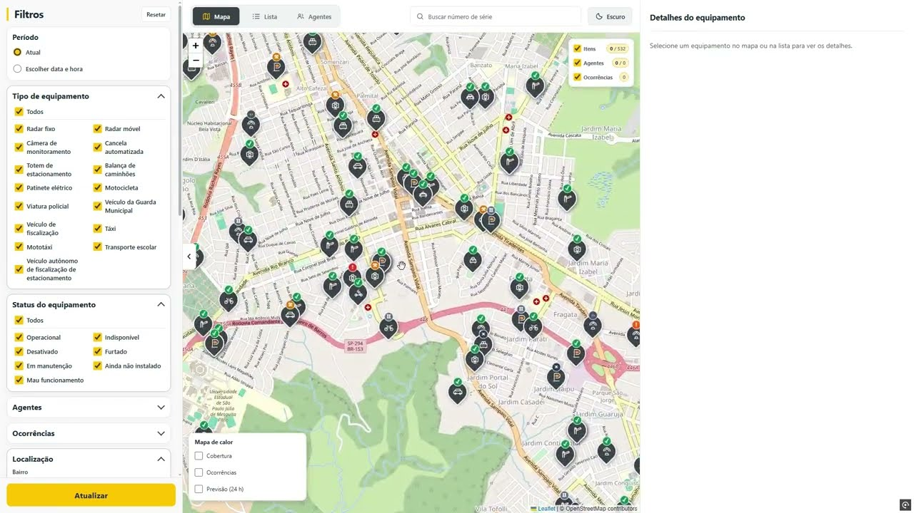
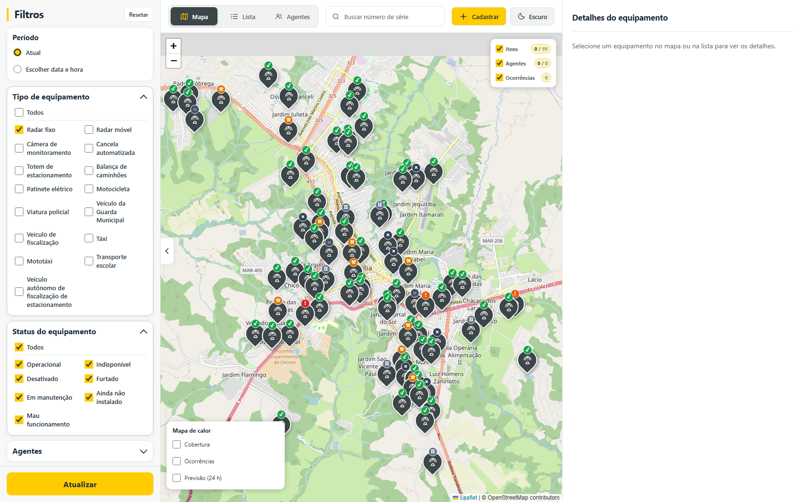

# F.O.G.O. — Ferramenta de Operação e Gestão de Ocorrências

O F.O.G.O. é um protótipo de gestão urbana que reúne equipamentos, agentes e ocorrências em um mapa interativo. A proposta é facilitar a consulta e a análise territorial: filtrar registros, acompanhar informações relacionadas e visualizar padrões por meio de mapas de calor e previsões demonstrativas.

O projeto foi desenvolvido para o **DSIN Coder Challenge**. Os dados operacionais e as previsões apresentados são sintéticos e servem para demonstrar a solução; não representam o risco real da cidade.

## Como foi feito

O projeto foi feito por mim com a ajuda do meu amigo **GPT-6 Luna**. Eu levava as ideias, testava as telas e apontava quando um mapa parecia uma “bola quadrada”; o Luna ajudava a investigar e transformar os ajustes em código. Eu no volante, ele no copiloto — e o mapa foi ficando mais fácil de navegar a cada volta.

Na parte técnica, usamos **React e TypeScript** no painel, **Leaflet** para o mapa, **Python com FastAPI** na API e **MySQL 8** para os dados. O **Docker Compose** reúne os serviços para facilitar a execução. O mapa usa a base do OpenStreetMap e a previsão demonstrativa organiza dados por setores censitários do IBGE de 2022.

## Assista à apresentação

Gravei uma demonstração do sistema, passando pelos filtros, mapas de calor, previsão e cadastros. Clique na imagem para assistir:

[](https://youtu.be/njqRZl8V750)

## Como executar após clonar

### Requisitos

- Git.
- Docker Desktop instalado e aberto, com suporte a containers Linux e Docker Compose v2.
- PowerShell no Windows. Em outros sistemas, use os comandos equivalentes para copiar o arquivo de ambiente e entrar na pasta.

### Passo a passo

1. Clone o repositório e entre na pasta:

   ```powershell
   git clone https://github.com/ThiagoBaso/dsin-fogo.git
   Set-Location dsin-fogo
   ```

2. Crie o arquivo local de configuração a partir do exemplo:

   ```powershell
   Copy-Item .env.docker.example .env
   ```

3. Abra o `.env` e troque as senhas de exemplo por senhas locais. Não compartilhe nem envie esse arquivo ao Git:

   ```powershell
   notepad .env
   ```

   As portas padrão são `8081` para o painel, `8000` para a API e `3307` para o MySQL. Se alguma já estiver ocupada, altere `FRONT_PUBLISHED_PORT`, `API_PUBLISHED_PORT` ou `MYSQL_PUBLISHED_PORT` no `.env`.

4. Construa as imagens e inicie os serviços:

   ```powershell
   docker compose up --build -d
   ```

   Na primeira execução, aguarde o banco ficar saudável, as migrações terminarem e a API e o painel iniciarem. Você pode acompanhar o estado com:

   ```powershell
   docker compose ps
   ```

5. Acesse o sistema:

   - **Painel:** <http://localhost:8081>
   - **Documentação interativa da API:** <http://localhost:8000/docs>
   - **Verificação de saúde da API:** <http://localhost:8000/api/health>
   - **MySQL:** `localhost:3307`, banco `fogo`

   O Compose carrega o schema e os dados de demonstração automaticamente quando cria um banco vazio. Em bancos existentes, executa as migrações disponíveis. Não é necessário gerar a seed manualmente para usar a aplicação.

### Comandos úteis

Ver logs da API:

```powershell
docker compose logs -f api
```

Parar os serviços:

```powershell
docker compose down
```

`docker compose down` mantém os dados no volume do MySQL. Evite `docker compose down -v`: essa opção remove o volume do banco e apaga os dados locais.

## Funcionalidades

### Mapa, filtros e detalhes

- Visualização geográfica de equipamentos, agentes e ocorrências, com filtros por categoria e atributos disponíveis.
- Seleção de registros no mapa e consulta de seus detalhes na lateral.
- Lista de equipamentos e agentes, busca por número de série e consulta de posições e trajetos demonstrativos de veículos.
- Opções independentes para controlar quais categorias aparecem no mapa e para ocultar marcadores individuais sem removê-los das análises de calor.



### Mapas de calor e análise territorial

- Mapa de calor de cobertura, calculado a partir dos equipamentos e agentes considerados pelos filtros.
- Análise de ocorrências por quantidade, gravidade, quantidade combinada com gravidade, recorrência do mesmo tipo e tempo de resolução.
- Previsão demonstrativa para as próximas 24 horas, agregada por áreas formadas a partir de setores censitários do IBGE de 2022, com quantidade esperada e chance de ocorrência grave.
- Tendências temporais e validação retrospectiva para comparar estimativas com os dados sintéticos do protótipo.

### Cadastros

- Formulários para cadastrar equipamentos, agentes e ocorrências, com campos específicos para cada tipo e seleção de localização no mapa.

> **Sobre os dados:** os registros, trajetos, tempos de resolução e resultados de previsão usados na demonstração são sintéticos. Eles permitem explorar as telas e o método, mas não devem ser interpretados como informação operacional ou previsão real.

## Ajustes e melhorias pendentes

- **Refinar os cadastros:** ampliar os fluxos para consultar, editar e atualizar registros, incluindo validações e histórico de alterações mais completos.
- **Completar os dados territoriais:** ainda falta uma fonte pública confiável e integrada para limites oficiais de bairros e outras divisões locais. A previsão usa setores censitários do IBGE de 2022, que não são equivalentes a bairros; algumas denominações territoriais do conjunto demonstrativo são aproximadas.
- **Aproximar os dados da realidade:** substituir gradualmente os dados sintéticos por bases operacionais ou públicas autorizadas e documentar a origem e a atualização de cada conjunto.
- **Validar a previsão com dados reais:** as métricas atuais comparam previsões simuladas a registros sintéticos; sua utilidade prática depende de histórico real suficiente e de avaliação com as equipes responsáveis.

## Ideias para implementações futuras

- Tela de login e gestão de usuários com níveis de acesso.
- Atualização em tempo real da posição e do deslocamento dos veículos, integrada a uma fonte de telemetria.
- Alertas em tempo real para ocorrências, mudanças de status e situações prioritárias.
- Acompanhamento e visualização de multas geradas por radares, mediante integração com os sistemas e dados oficiais correspondentes.
- Visualização do nível de trânsito por área, usando uma fonte de dados atualizada e devidamente licenciada.
- Integração contínua com bases públicas e serviços municipais para reduzir a dependência de dados de demonstração.
